  <a href="https://bpsstudio.vercel.app/">Portfolio</a> ·
  <a href="https://discord.com/users/463458936985485314">Discord</a> ·
  <a href="#português">Português</a>

  
  

  
  
  

If one of these helped you, a ★ on its repo is the best thanks.

### About

I'm from Rio de Janeiro, and I make the things I wanted to exist. Most projects have a README in English and Portuguese.

I write C, Rust, Python, C# and TypeScript, and ship to the PS5, Windows, Docker and the web.

### More

- **[Fluxa](https://usefluxa.pages.dev)**: a WhatsApp sales CRM where every lead has a next step.
- **[Principium](https://getprincipium.com)**: visual desktop automation with screen reading, OCR and task queues.
- **[chamadafacil](https://github.com/bps2414/chamadafacil)**: support tickets with an admin panel and urgency levels.
- **[mdview](https://github.com/bps2414/mdview)**, **[net-monitor](https://github.com/bps2414/net-monitor)**, **[ps5-updater](https://github.com/bps2414/ps5-updater)**, **[enxuto](https://github.com/bps2414/enxuto)**: small tools I use every day.

Sites for local businesses

 

[Barbearia da Vila](https://barbeariadavila.vercel.app) •
[Alpha Barber Club](https://alphabarbearia-livid.vercel.app/) •
[Dom Lucas](https://domlucasbarber.vercel.app/) •
[Boca Odontologia](https://bocaodontologia.vercel.app/) •
[Valença & Prado](https://valencaprado.vercel.app/) •
[Dra. Marina Castell](https://dra-marina-castell.pages.dev) •
[Brisa Climatização](https://brisaponto.pages.dev) •
[Paulistar](https://paulistar.vercel.app/) •
[RefriClima](https://refriclima-servicos.pages.dev) •
[Hélio Solar](https://helio-solar.pages.dev) •
[Vértice Vidros](https://vertice-vidros.pages.dev) •
[Pluma Estofados](https://pluma-estofados.pages.dev) •
[Xô! Dedetização](https://xo-dedetizacao.pages.dev) •
[Garra Academia](https://garra-academia.pages.dev)

Case studies are on the [portfolio](https://bpsstudio.vercel.app/).

### Português

Sobre mim

 

Sou do Rio de Janeiro e faço o que eu queria que existisse. A maioria dos projetos tem README em português e inglês.

Escrevo em C, Rust, Python, C# e TypeScript, pro PS5, Windows, Docker e web. Se algum projeto te ajudou, uma ★ no repo ajuda muito.

The header and the cards are generated by [`scripts/make_profile.mjs`](scripts/make_profile.mjs): the calçadão of Copacabana, stone by stone.
